# ⚡ Awesome ITSM Integration (ServiceNow & Jira)

  

  
  
  
  
  
  

---

## 🧭 Curated Guide to ITSM Integration & Ticket Automation Ecosystem

> A curated directory of enterprise **SaaS platforms**, bidirectional connectors, workflow automation engines, and active **open-source GitHub projects** for bridging **ServiceNow**, **Jira Service Management**, and DevOps toolchains.

Synchronize incidents, changes, service requests, alerts, and CMDB configuration items in real-time between enterprise service desks, monitoring stacks, incident response platforms, and developer issue trackers.

📅 **Last updated:** November 2026

---

## 📑 Table of Contents

- [📊 Sector Overview & Market Dynamics](#-sector-overview--market-dynamics)
- [🏢 SaaS & Hosted Platforms](#-saas--hosted-platforms)
- [🔓 Open-Source GitHub Projects](#-open-source-github-projects)
  - [Top Open-Source Projects (Ranked by GitHub Stars)](#top-open-source-projects-ranked-by-github-stars)
  - [Modular Libraries, SDKs & Webhook Bridges](#modular-libraries-sdks--webhook-bridges)
- [🤝 How to Contribute](#-how-to-contribute)
- [💖 Support & Sponsorship](#-support--sponsorship)
- [📈 Star History](#-star-history)
- [⚖️ Disclaimer](#️-disclaimer)

---

## 📊 Sector Overview & Market Dynamics

The global **IT Service Management (ITSM)** software market is estimated at approximately **$14.8 billion to $17.4 billion in 2026**, expanding toward $30B+ by the early 2030s at a compound annual growth rate (CAGR) of ~13–14%. 

The sector exhibits a distinct **hybrid market structure**:
* **Enterprise Platform Consolidation (High Concentration):** Dominated by powerhouse platform vendors—most prominently **ServiceNow**, alongside **Atlassian (Jira Service Management)** and **BMC Software**—in a near winner-take-most dynamic driven by the convergence of ITSM, Enterprise Service Management (ESM), ITAM, and autonomous AI agents.
* **Mid-Market & SMB Agility (Moderate-to-High Fragmentation):** Thriving ecosystem of agile challengers (such as Freshservice, HaloITSM, Zendesk, and SysAid) and self-hosted open-source platforms (n8n, Plane, Zammad, GLPI) competing vigorously on rapid deployment, modular architectures, and transparent total cost of ownership (TCO).

---

## 🏢 SaaS & Hosted Platforms

Enterprise cloud solutions sorted descending by **Company Valuation / Scale**:

| Platform | Company Valuation / Revenue | Pricing | Free Tier Limits | Key ITSM & Integration Capabilities |
| :--- | :--- | :--- | :--- | :--- |
| **[ServiceNow ITSM & Integration Hub](https://servicenow.com)** | ~$130B Market Cap / ~$13.3B FY2025 Revenue | Starts at ~$70 - $100/fulfiller/month (Foundation tier, billed annually) | No production free tier or commercial free trial; non-production Personal Developer Instance (PDI) available free for learning (auto-reclaimed after 10 days of inactivity) | Enterprise ITSM suite with Integration Hub spokes for bidirectional synchronization with Jira, Slack, Azure DevOps, monitoring, and backup platforms. |
| **[Jira Service Management](https://atlassian.com)** (Atlassian) | ~$38B Market Cap / ~$5.2B FY2025 Revenue | Starts at $20 - $23.80/agent/month (Standard tier) | Free forever plan available: strictly limited to **up to 3 agents**, 2 GB file storage, 100 email notifications/day, and unlimited customer requestors | Collaborative ITSM platform bridging development and operations with native Jira Software linking, Opsgenie alerting, and REST/webhook integrations. |
| **[Zendesk Support](https://zendesk.com)** | ~$10.2B Acquisition Valuation / ~$1.7B ARR | Starts at $19/agent/month (Support Team, billed annually) | No permanent free plan; offers a **14-day free trial** with full access to Zendesk Suite Professional features (no credit card required) | Omnichannel support and helpdesk suite with dedicated Jira and ServiceNow marketplace apps for escalating customer issues into engineering tickets. |
| **[BMC Helix ITSM](https://bmc.com)** | ~$8.3B Buyout Valuation / ~$2.3B Revenue | Starts at ~$115 - $130/user/month (estimated list pricing for named agents, annual contracts) | No self-service free tier or public trial; enterprise proof-of-concept (PoC) sandboxes available upon sales consultation | Enterprise multi-cloud service management providing automated ticket brokering across Jira, ServiceNow, AWS, and Salesforce ecosystems. |
| **[Freshservice](https://freshworks.com)** (Freshworks) | ~$3.3B Market Cap / ~$930M ARR | Starts at $19/agent/month (Starter tier, billed annually) | No permanent free plan; provides a **14-day free trial** with enterprise-tier feature access and trial agent day passes (no credit card required) | Cloud-native ITSM suite with an App Marketplace featuring turnkey connectors for Jira, ServiceNow orchestration, Azure AD, and DevOps pipelines. |
| **[SolarWinds Service Desk](https://solarwinds.com)** | ~$3.2B Market Cap / ~$797M Revenue | Starts at $39/technician/month (Essentials tier, billed annually) | No permanent free plan; offers a **30-day fully functional free trial** with complete access to Premier-tier AI, automation, and asset features | Cloud ITSM platform featuring built-in integrations for Jira issue tracking, Orion monitoring alerts, and automated change workflows. |
| **[Ivanti Neurons for ITSM](https://ivanti.com)** | ~$2.0B Valuation / ~$1.2B - $1.5B Revenue | Starts at ~$25 - $59/user/year (baseline editions) to ~$95/analyst/month (advanced modules) | No self-service free tier or open trial; custom-guided enterprise demonstrations and sales-led evaluation sandboxes only | Enterprise service management offering bidirectional connectors for Jira, ServiceNow, endpoint management, and self-healing automation bots. |
| **[HaloITSM](https://haloitsm.com)** | ~$2.0B Valuation / ~$100M ARR | Starts at £65 - £69/agent/month (approx. $49 - $99/agent/month depending on team volume) | No permanent free plan; offers an unrestricted **30-day free trial** with all ITSM modules and integrations included (no credit card required) | Modern ITIL service desk providing two-way Jira and Azure DevOps synchronization, webhook automation, asset management, and custom REST API integrations. |
| **[Druva Service Management](https://druva.com)** | ~$2.0B Valuation / ~$200M+ ARR | Starts at $8/user/month (SaaS/endpoint backup) or custom TB/month consumption for cloud infrastructure | No permanent free plan; offers a **30-day free trial** for cloud and SaaS workload data protection (no credit card required) | Cloud data resiliency platform with native ServiceNow and Jira integrations to automate backup failure ticketing, cyber recovery, and legal hold workflows. |
| **[SysAid](https://sysaid.com)** | ~$30M Raised / ~$30M - $37M Revenue | Starts at $89/agent/month (Professional AI plan, billed annually) | No permanent free plan; offers a **14-day free trial** with access to core ITSM, AI Copilot, and asset management modules (no credit card required) | Service management platform featuring native Jira integration, automated alert-to-ticket creation, and IT asset synchronization. |

---

## 🔓 Open-Source GitHub Projects

### Top Open-Source Projects (Ranked by GitHub Stars)

The following active open-source projects power self-hosted ITSM, bidirectional issue syncing, AIOps alert-to-incident ingestion, runbook automation, and developer portals. Each entry includes its live GitHub stargazer badge:

1. **[n8n](https://github.com/n8n-io/n8n)**   
   Leading open-source workflow automation platform with native ServiceNow, Jira, Zendesk, Freshdesk, and webhook nodes for building complex bidirectional ITSM synchronization pipelines.

2. **[Plane](https://github.com/makeplane/plane)**   
   Modern open-source software development and issue tracking alternative to Jira, featuring extensible webhooks, REST APIs, and modular workflows for engineering and IT operations teams.

3. **[Backstage](https://github.com/backstage/backstage)**   
   Spotify's open-source developer portal platform with rich ecosystem plugins for surfacing Jira issue trackers, ServiceNow ITSM change approvals, and CI/CD pipelines in a unified catalog.

4. **[Huly](https://github.com/hcengineering/platform)**   
   All-in-one open-source workspace and ticketing environment combining Jira-style issue tracking, project planning, knowledge base, and team chat with flexible event integrations.

5. **[Activepieces](https://github.com/activepieces/activepieces)**   
   Open-source no-code/low-code business automation tool providing turnkey triggers and actions for Jira, Slack, Zendesk, Freshdesk, and enterprise webhook integrations.

6. **[NetBox](https://github.com/netbox-community/netbox)**   
   Premier open-source IPAM and DCIM infrastructure source of truth, widely integrated with ServiceNow CMDB and Jira Service Management for asset lifecycle synchronization.

7. **[Windmill](https://github.com/windmill-labs/windmill)**   
   High-performance open-source developer platform for turning Python, TypeScript, and SQL scripts into secure workflows, UIs, and background jobs syncing ServiceNow and Jira records.

8. **[OpenProject](https://github.com/opf/openproject)**   
   Enterprise open-source project and issue management software supporting agile boards, ITIL change tracking, GitHub/GitLab integration, and robust REST APIs.

9. **[Keep](https://github.com/keephq/keep)**   
   Open-source AIOps and alert deduplication platform providing two-way integrations with ServiceNow, Jira, and 50+ observability tools to auto-create, enrich, and resolve tickets.

10. **[Prometheus Alertmanager](https://github.com/prometheus/alertmanager)**   
    Core open-source alert routing engine that deduplicates, groups, and routes infrastructure alerts into ServiceNow, Jira Service Management, and incident channels via custom webhooks.

11. **[GLPI](https://github.com/glpi-project/glpi)**   
    Flagship open-source ITSM and CMDB platform featuring extensive REST APIs, webhooks, and plugins for synchronizing incidents, requests, and assets with external issue trackers.

12. **[StackStorm](https://github.com/StackStorm/st2)**   
    Event-driven automation platform ("IFTTT for Ops") equipped with specialized ServiceNow and Jira packs to automate ticket enrichment, diagnosis, and remediation workflows.

13. **[Dispatch](https://github.com/Netflix/dispatch)** (by Netflix)   
    Open-source incident management and orchestration framework that coordinates incident resolution by automatically opening Jira tickets, provisioning Slack war rooms, and managing timelines.

14. **[Rundeck](https://github.com/rundeck/rundeck)**   
    Open-source runbook automation engine commonly paired with ServiceNow and Jira to execute self-service IT operations and auto-remediations upon ticket approval.

15. **[Zammad](https://github.com/zammad/zammad)**   
    Modern open-source helpdesk and customer support ticketing system offering native Jira, GitLab, GitHub, and monitoring integrations (Nagios, Checkmk) out of the box.

16. **[Redmine](https://github.com/redmine/redmine)**   
    Time-tested, flexible open-source issue tracker and project management platform supported by a vast ecosystem of community plugins for ServiceNow and Jira bidirectional sync.

17. **[Grafana OnCall](https://github.com/grafana/oncall)**   
    Developer-friendly open-source on-call scheduling and paging system equipped with webhook engines to automatically dispatch and synchronize Jira and ServiceNow incident records.

18. **[Apache DevLake](https://github.com/apache/incubator-devlake)**   
    Open-source DevOps data lake that ingests, correlates, and analyzes engineering and incident data across Jira, GitHub, GitLab, and enterprise ITSM systems into DORA metrics.

19. **[Alerta](https://github.com/alerta/alerta)**   
    Scalable open-source alert monitoring console with plug-and-play integrations for escalating monitoring events into Jira issues and ServiceNow incidents.

20. **[iTop](https://github.com/combodo/itop)**   
    Complete open-source ITIL service management portal and CMDB platform featuring modular REST/JSON APIs, webhook triggers, and external issue tracker connectors.

21. **[Taiga](https://github.com/taigaio/taiga-back)**   
    Open-source agile project management platform with customizable webhooks and REST endpoints for bridging customer support queues with developer sprints.

22. **[Znuny](https://github.com/znuny/Znuny)**   
    Enterprise open-source service management fork of OTRS featuring a mature Generic Interface (REST/SOAP web services) designed for enterprise ServiceNow and Jira ticket federation.

23. **[OTOBO](https://github.com/RotherOSS/otobo)**   
    Modernized open-source OTRS-based service desk and ITIL management system with native connectors for synchronizing incidents, changes, and assets with enterprise tools.

24. **[Ansible ServiceNow ITSM Collection](https://github.com/ansible-collections/servicenow.itsm)**   
    Official Red Hat Ansible collection for automating ServiceNow ITSM configuration items (CMDB), incident creation, change request approvals, and service catalog tasks.

---

### 🧩 Modular Libraries, SDKs & Webhook Bridges

For engineers building bespoke microservices and bidirectional synchronization daemons:

* 🐍 **Python Ecosystem:**
  * [`pysnow`](https://github.com/rbw/pysnow) — Lightweight Python library for ServiceNow REST API interactions.
  * [`atlassian-python-api`](https://github.com/atlassian-api/atlassian-python-api) — Comprehensive Python wrapper for Jira, Confluence, and Jira Service Management REST APIs.
* ☕ **Node.js & TypeScript:**
  * [`jira.js`](https://github.com/MrRefactoring/jira.js) — Modern TypeScript/JavaScript SDK for Jira Cloud and Server REST APIs.
* 🔔 **Webhook Translators:**
  * Custom Prometheus Alertmanager to ServiceNow Incident bridges (e.g., `prometheus-servicenow-webhook`).
  * Bidirectional sync daemons bridging Jira webhooks with ServiceNow REST Scripted APIs.

---

## 🤝 How to Contribute

Contributions are warmly welcomed! Help make this the most comprehensive and up-to-date guide for ITSM and Jira integration:

1. 🍴 **Fork the repository** on GitHub.
2. 📝 **Add or improve entries** in `README.md` (keep descriptions clear, factual, and include links to official resources).
3. 🏷️ **Follow formatting standards**: If adding SaaS tools, include exact pricing and free tier/trial limits. If adding open-source projects, link to the repo and stargazers page.
4. 🚀 **Submit a Pull Request** with a brief summary of your additions.

---

## 💖 Support & Sponsorship

If you find this curated resource helpful for your architecture, DevOps pipelines, or ITSM integration projects, please consider supporting the project:

- ⭐ **Star this repository** to help others discover it.
- 🍴 **Fork and share** with your DevOps and ITSM engineering teams.
- ☕ **Sponsor or buy a coffee**: Support ongoing maintenance through the [GitHub Sponsors Dashboard](https://github.com/sponsors/ishandutta2007).

---

## 📈 Star History

---

## ⚖️ Disclaimer

* This repository is an independent community-curated compilation and is not affiliated with, endorsed by, or sponsored by ServiceNow, Atlassian, BMC Software, Freshworks, Zendesk, or any of their respective subsidiaries or affiliates.
* Product names, logos, and brands are property of their respective owners.
